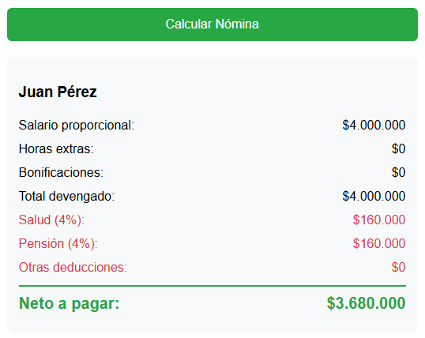

# Calculadora de Nómina

Herramienta empresarial desarrollada en **.NET 8 Web API** que calcula la nómina mensual de un empleado en Colombia, incluyendo deducciones de ley (salud y pensión), horas extras, bonificaciones y neto a pagar. Containerizada con **Docker**.

## 🛠️ Tecnologías

- .NET 8 Web API
- C#
- HTML + JavaScript (frontend)
- Docker + Docker Compose
- Lógica de negocio colombiana

## 🚀 Funcionalidades

- ✅ Cálculo de salario proporcional por días trabajados
- ✅ Pago de horas extras
- ✅ Bonificaciones
- ✅ Deducciones de ley (4% salud + 4% pensión) solo si el salario supera 2 SMMLV
- ✅ Otras deducciones personalizadas
- ✅ Cálculo de neto a pagar
- ✅ Interfaz web intuitiva

## 📸 Capturas

### Formulario


### Resultado


## ⚙️ Cómo ejecutar

### Requisitos
- Docker Desktop instalado
- WSL 2 (si estás en Windows)

### Pasos

1. Clonar el repositorio:
   ```bash
   git clone https://github.com/jesidcampos/CalculadoraNomina.git
   cd CalculadoraNomina

2. Levantar los contenedores:

docker compose up --build

3. Abrir en el navegador:

http://localhost:8082

Detener la aplicación

docker compose down

📂 Estructura del proyecto

CalculadoraNomina/
├── Controllers/
│   └── NominaController.cs
├── Models/
│   └── Empleado.cs
├── Services/
│   └── NominaService.cs
├── wwwroot/
│   └── index.html
├── Dockerfile
├── docker-compose.yml
└── README.md

💡 Reglas de negocio
Salario mínimo Colombia 2025: $1.423.500

Deducciones de ley: Se aplican solo cuando el salario básico supera 2 SMMLV ($2.847.000).

Salud: 4% del total devengado.

Pensión: 4% del total devengado.

Salario proporcional: (Salario básico / 30) × Días trabajados.

👤 Autor
José Yesid Campos Barbosa

Ingeniero de Sistemas | Desarrollador .NET | Soporte Técnico Remoto

LinkedIn: yesid-campos-barbosa

GitHub: @jesidcampos